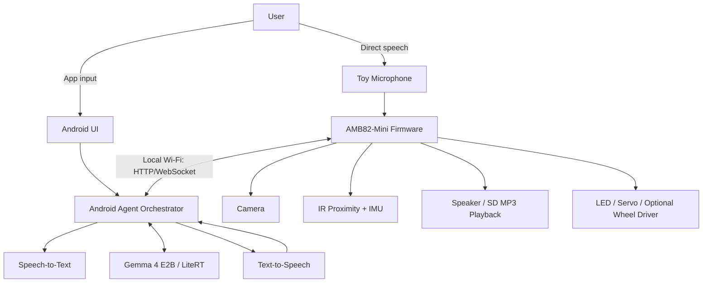

# PROPOSAL: Agentic AI Plush Toy Using AMB82-Mini and Gemma 4 E2B

**Date:** 2026-10-15  
**Status:** Concept and prototype proposal

## 1. Executive Summary

Develop an interactive AI plush toy combining a Realtek AMB82-Mini embedded controller with a Gemma 4 E2B model running on an Android device. The toy supports two interaction modes: (A) interaction through a Google AI Edge Gallery-based app and (B) direct speech to the plush toy while a nearby Android device performs AI inference. A hybrid design shares the same sensing, reasoning, and actuation services across both modes.

**Core architectural principle:** AMB82-Mini handles sensors, local reflexes, media playback, and bounded actuator control; Android handles model inference, speech recognition/synthesis, conversation context, and agent orchestration.

## 2. Project Objectives

- Build a compact, responsive plush companion with camera, microphone, speaker, proximity and motion sensors.
- Enable natural language interaction via smartphone UI and directly via the toy.
- Provide agent tools for sensing, playback, expression, and optional mobility.
- Keep basic responses operational when the Android inference service is temporarily unavailable.
- Design for privacy, predictable behavior, battery safety, and future hardware expansion.

## 3. Two Interaction Modes

### Mode A: Android App Interface

**Flow:** User → Android Edge AI app → Gemma 4 E2B → Agent tools → Wi-Fi → AMB82-Mini → Toy.

The phone provides the interface and may capture speech, while AMB82-Mini reports sensor data and executes validated commands. This is the preferred first milestone because it simplifies audio streaming and debugging.

### Mode B: Direct Voice Interaction

**Flow:** User speech → Toy microphone → AMB82-Mini → Wi-Fi audio stream → Android STT → Gemma agent → TTS → Wi-Fi → AMB82-Mini speaker.

The user speaks directly to the toy, without needing to touch the phone. The Android device still hosts inference. Background operation and low-latency audio depend on Android permissions, device performance, and application architecture.

| Aspect | Mode A: App | Mode B: Direct Voice |
|---|---|---|
| Primary user interface | Phone screen/mic | Toy microphone/speaker |
| Gemma inference | Android | Android |
| Firmware complexity | Lower | Higher |
| Audio streaming | Optional | Required |
| Interaction experience | Controlled/testing | Natural/hands-free |
| Recommended stage | First | After core API works |

## 4. System Architecture



**Note:** Google AI Edge Gallery model execution and its external tool/skill APIs must be verified against the specific app release. If it cannot expose the necessary network agent interface, implement a companion Android app using a supported LiteRT inference runtime and explicit tool dispatcher.

## 5. Hardware Architecture and Preliminary BOM

| Component | Purpose | Notes |
|---|---|---|
| AMB82-Mini board | Embedded controller | Confirm exact board pinout, SDK support, and interfaces |
| Compatible camera | Image capture | Match board camera interface |
| Microphone / audio front end | Voice input | Confirm codec, sampling, and streaming support |
| Amplifier + small speaker | Speech and effects | Volume limited for near-ear use |
| microSD card | Local MP3, effects, configuration | Supported interface and file system required |
| IR proximity sensor | Nearby-object detection | Calibrate range and false triggers |
| IMU | Pickup, tilt, motion events | I2C/SPI depending on module |
| LED / optional servo | Expressions and gestures | Current limiting and mechanical guards |
| Optional motor driver + wheels | Mobile version | Separate motor supply, stop controls |
| Protected battery + charging/power board | Portable power | Use appropriate certified modules and protected enclosure |
| Power switch / mic disable | User control | Clear power and recording state |
| Android phone/tablet | Gemma inference host | Benchmark RAM, latency, and thermal behavior |

**Electrical integration:** Final wiring and pin assignments must be determined from the selected AMB82-Mini revision, sensor modules, voltage levels, peak currents, and verified audio peripherals. Do not connect motors or speakers directly to GPIO pins.

## 6. Software Modules

### AMB82-Mini Firmware

1. `SensorManager`: IR, IMU, camera events.
2. `AudioCapture`: microphone input, framing, buffering, and streaming.
3. `AudioPlayer`: SD-card MP3 playback and incoming TTS audio playback.
4. `DeviceAPI`: authenticated local HTTP/WebSocket messages.
5. `ActionController`: LEDs, servo gestures, and optional bounded motor commands.
6. `ReflexEngine`: offline proximity greetings and motion-triggered effects.
7. `SafetyManager`: watchdog, thermal/power checks, motor timeout, safe idle.

### Android AI Host

1. `GemmaRuntime`: on-device Gemma 4 E2B inference.
2. `AgentOrchestrator`: dialogue state, tool invocation, response policy.
3. `SpeechService`: STT, voice activity detection, TTS, turn-taking.
4. `VisionService`: image retrieval and supported model vision input, if available.
5. `DeviceClient`: secure Wi-Fi discovery, API transport, retries, telemetry.
6. `PrivacyControls`: permissions, data retention, recording indicator, deletion.

## 7. Agent API Proposal

Use a versioned JSON protocol with a request ID, device ID, action name, parameters, and status response. All actions must be whitelisted and validated in firmware.

### Example Command

```json
{
  "version": "1.0",
  "request_id": "req-001",
  "device_id": "plush-01",
  "action": "respond",
  "parameters": {
    "speech": "Hello! Nice to see you!",
    "audio_mode": "tts",
    "emotion": "happy",
    "gesture": "wave",
    "led": "warm_yellow"
  }
}
```

### Proposed Tools

| Tool | Description | Safety / Validation |
|---|---|---|
| `get_sensor_status` | Read IR, IMU, power state | Rate-limit polling |
| `capture_image` | Capture image on explicit authorized request | Indicate camera use |
| `play_audio` | Play approved SD-card clip | Restrict paths and volume |
| `speak` | Play generated speech stream | Bound volume/duration |
| `set_expression` | Set LED/expression state | Allowed values only |
| `perform_gesture` | Execute preset servo gesture | Position/speed limits |
| `stop_motion` | Immediately stop movement | Always available locally |
| `move` (optional) | Short bounded wheel movement | Proximity checks, timeout, speed limits |

**Transport:** HTTP for commands/status and WebSocket or another suitable streaming protocol for low-latency audio. Implement pairing/authentication; avoid exposing an unauthenticated control API on the local network.

## 8. Example Interaction Scenarios

**Greeting:** IR detects nearby person → firmware plays local greeting immediately → optional agent generates contextual follow-up.

**Visual question:** User asks “What am I holding?” → authorized image capture → Android visual interpretation if supported → generated spoken answer. Avoid claiming reliable visual recognition until tested.

**Storytelling:** User asks for a story → STT → Gemma generates age-appropriate story → TTS → toy speaker; optional LED expressions accompany narration.

**Pickup reaction:** IMU detects lift/tilt → local reflex sound and expression; agent may follow with conversational response.

**Connection loss:** Device enters local-only mode, supports preloaded sound effects, and does not initiate autonomous movement.

## 9. Development Roadmap

| Phase | Deliverable | Exit Criteria |
|---|---|---|
| 1. Hardware bring-up | Sensors, camera, SD audio, Wi-Fi | Individual peripherals pass tests |
| 2. Device API | Command/status protocol | Reliable authenticated command exchange |
| 3. Android agent | Gemma tool invocation | Agent calls real toy tools correctly |
| 4. App interaction | Mode A demonstration | User controls toy via phone |
| 5. Direct voice | Streaming STT/TTS pipeline | Two-way voice exchange with acceptable latency |
| 6. Autonomous behaviors | Reflex + agent coordination | Predictable triggers and safe fallback |
| 7. Integrated prototype | Enclosed plush device | Thermal, power, privacy, and motion tests |

## 10. Validation and Performance Metrics

- Measure end-to-end response latency separately for Mode A and Mode B.
- Benchmark STT word accuracy in quiet and noisy environments.
- Measure model inference time, memory consumption, battery life, and device temperature.
- Validate audio quality, echo handling, and speech interruption behavior.
- Test Wi-Fi disconnect/reconnect and incomplete-command recovery.
- Verify physical stop, servo limits, optional wheel timeout, and safe power behavior.
- Verify camera/microphone indicators, consent controls, and local data deletion.

Targets should be established after the first hardware and Android inference benchmarks rather than assumed in advance.

## 11. Risks and Mitigations

| Risk | Mitigation |
|---|---|
| Edge Gallery tool API limitations | Verify current API; fall back to a custom Android companion app |
| High speech round-trip latency | Stream audio, use VAD, pre-cache common audio, profile each stage |
| Microphone feedback from speaker | Half-duplex first, then echo cancellation |
| Unreliable model tool output | Structured schema, strict firmware validation, deterministic fallback |
| Privacy of audio/video | On-device processing where feasible, visible indicators, opt-in capture |
| Power and heat inside plush | Protected power system, thermal tests, isolated electronics enclosure |
| Unsafe motion | Local safety interlocks, limited commands, fail-safe stop |

## 12. Recommended Minimum Viable Prototype

Start with **Mode A** using AMB82-Mini, a compatible camera, microphone, speaker, microSD, IR sensor, IMU, and Android Gemma host. Implement three agent tools first: `get_sensor_status`, `capture_image`, and `play_audio`. Add direct speech (Mode B) once tool calling and connectivity are stable. Keep wheel motors optional until the stationary toy is validated.

## 13. Open Technical Decisions

1. Exact AMB82-Mini board revision, available GPIO, camera, and audio interface.
2. Android phone hardware and Gemma 4 E2B model/runtime availability.
3. Whether Google AI Edge Gallery exposes the needed tool/skill integration, or a custom host is required.
4. Speech stack: Android native STT/TTS versus separately deployed on-device models.
5. Audio format, sample rate, transport, and buffering strategy.
6. Power source, expected operating time, enclosure size, and whether mobility is needed.

## 14. Conclusion

A **hybrid Android AI host + AMB82-Mini physical controller** is the most practical architecture. It supports both phone-mediated interaction and natural direct-toy conversation while avoiding the unrealistic requirement to execute a large language model on the microcontroller. Development should proceed incrementally, with safety, privacy, and measurable latency treated as core design requirements.
