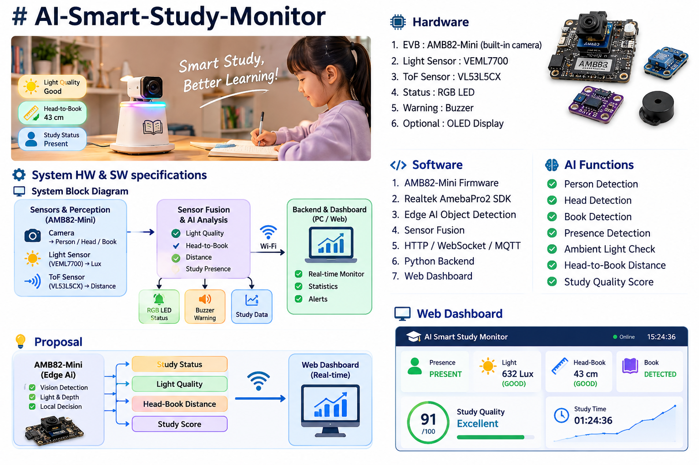

# AI-Smart-Study-Monitor



## System HW & SW specifications

### System Block Diagram

```text
                 ┌─────────────────────────────┐
                 │        AMB82-Mini            │
                 │  Camera + Edge AI + Wi-Fi   │
                 └──────────────┬──────────────┘
                                │
             ┌──────────────────┼──────────────────┐
             │                  │                  │
             ▼                  ▼                  ▼
       Person / Head       VEML7700 / BH1750   VL53L5CX
        / Book AI            Light Sensor       ToF Sensor
             │                  │                  │
             └──────────────────┼──────────────────┘
                                ▼
                     ┌─────────────────────┐
                     │ Sensor Fusion /     │
                     │ Study Status        │
                     └──────────┬──────────┘
                                │
                 ┌──────────────┼──────────────┐
                 ▼              ▼              ▼
              RGB LED         Buzzer       Web Dashboard
```

### AI / Edge Processing

- AMB82-Mini is the main edge device.
- Camera-based AI detects:
  - Person
  - Head
  - Book / study area
- Lightweight / quantized models are preferred for edge inference.
- Sensor data and AI detection results are combined to estimate study status.

### Hardware

1. **EVB:** AMB82-Mini (built-in camera and Wi-Fi)
2. **Light Sensor:** VEML7700 / BH1750
3. **Distance Sensor:** VL53L5CX ToF
4. **Status Indicator:** RGB LED
5. **Warning:** Buzzer
6. **Optional:** OLED display / microSD card

### Software

- AMB82-Mini firmware
- Edge AI inference
- Sensor fusion
- HTTP / MQTT communication
- Web Dashboard
- Optional Android / AI Edge Gallery integration

### Main Functions

#### 1. Study Presence Detection

Detect whether the student is currently sitting at the study desk.

```text
Person detected
      │
      ├── Yes ──> Continue monitoring
      │
      └── No ───> AWAY
```

#### 2. Head-to-Book Distance

Use camera and ToF information to estimate the distance between the student's head and the book.

Prototype thresholds:

```text
> 45 cm       GOOD
35 ~ 45 cm    NORMAL
< 35 cm       WARNING
< 30 cm       HIGH WARNING
```

> The thresholds are prototype values and should be calibrated experimentally for the actual desk, camera angle, and user.

#### 3. Study Lighting Detection

Use a light sensor to measure the actual ambient illumination around the study area.

```text
Light Sensor
     │
     ▼
   Lux Value
     │
     ├── Suitable ──> GOOD
     │
     └── Too dark / unsuitable ──> WARNING
```

The final lux thresholds should be calibrated according to the desk environment and intended use.

#### 4. Study Status

The system combines:

- Person detection
- Head / book detection
- Head-to-book distance
- Ambient light level

to determine the current study condition.

Example:

```text
GOOD
WARNING_DISTANCE
WARNING_LIGHT
AWAY
NO_BOOK
```

#### 5. Warning System

When an abnormal condition is detected:

```text
Distance too close
        │
        ▼
     RGB LED
        +
     Buzzer
```

The warning behavior can be adjusted in firmware.

### Example Data Format

```json
{
  "person_detected": true,
  "book_detected": true,
  "head_book_distance_cm": 42.5,
  "ambient_lux": 520,
  "study_status": "GOOD"
}
```

### Communication

The AMB82-Mini can expose a small semantic API for higher-level applications.

Example:

```text
GET /status

{
  "person": true,
  "book": true,
  "distance_cm": 42.5,
  "lux": 520,
  "status": "GOOD"
}
```

Possible communication methods:

- HTTP
- MQTT
- Wi-Fi event messages

---

## Prompts: ChatGPT

Example prompt for AI-assisted development:

```text
I am developing an AI Smart Study Monitor using AMB82-Mini.

The system should:
1. Detect whether a student is sitting at the desk.
2. Detect the head and book.
3. Estimate head-to-book distance.
4. Measure ambient light.
5. Determine whether the current study condition is good.
6. Warn the student when the distance is too close or lighting is unsuitable.

Please help me design the embedded firmware, AI pipeline,
sensor fusion logic, and web dashboard while keeping the
edge-side computation lightweight.
```

---

## Proposal

```text
                  ┌─────────────────────────┐
                  │      Android Device     │
                  │ AI Edge Gallery / Agent │
                  │ Higher-level reasoning  │
                  └────────────┬────────────┘
                               │
                       Semantic API / Events
                               │
                               ▼
                  ┌─────────────────────────┐
                  │       AMB82-Mini        │
                  │   Embedded Controller   │
                  ├─────────────────────────┤
                  │ Camera / Edge AI        │
                  │ Light Sensor            │
                  │ ToF Sensor              │
                  │ LED / Buzzer             │
                  │ Wi-Fi                   │
                  └─────────────────────────┘
```

### System Architecture Diagram

```text
                Perception Layer
        ┌─────────────────────────────┐
        │ Camera                      │
        │ Light Sensor                │
        │ ToF Sensor                  │
        └──────────────┬──────────────┘
                       ▼
                Edge Processing
        ┌─────────────────────────────┐
        │ Person / Head / Book AI     │
        │ Distance Estimation         │
        │ Lux Measurement             │
        │ Sensor Fusion               │
        └──────────────┬──────────────┘
                       ▼
                  Study State
        ┌─────────────────────────────┐
        │ GOOD / WARNING / AWAY       │
        └──────────────┬──────────────┘
                       │
              ┌────────┴────────┐
              ▼                 ▼
        Local Feedback      Agent / Cloud
        LED + Buzzer        Web / Android
```

The architecture follows the compact embedded-controller approach: AMB82-Mini performs deterministic and fast local functions, while a higher-level application can provide additional reasoning and visualization.

---

## ProtoTyping

### V1 — Basic Monitoring

- AMB82-Mini camera
- Light sensor
- RGB LED
- Person detection
- Basic lighting evaluation

```text
Camera + Light Sensor
          │
          ▼
      AMB82-Mini
          │
          ▼
       LED Status
```

### V2 — Distance Monitoring

Add:

- VL53L5CX ToF sensor
- Head-to-book distance estimation
- Buzzer warning

```text
Camera ───────┐
              ├──> Sensor Fusion ──> Warning
ToF ──────────┘
```

### V3 — Smart Study Monitor

Add:

- Full sensor fusion
- Study quality score
- Web Dashboard
- Wi-Fi event reporting
- Historical study data
- Optional Android / AI Edge Gallery integration

```text
        AMB82-Mini
             │
     ┌───────┴────────┐
     ▼                ▼
 Edge AI          Sensors
     │                │
     └───────┬────────┘
             ▼
       Study Analysis
             │
       ┌─────┴─────┐
       ▼           ▼
   Local Alert   Dashboard
```

---

## Repository Structure

```text
AI-Smart-Study-Monitor/
├── firmware/
│   ├── camera/
│   ├── sensors/
│   ├── ai/
│   └── communication/
├── models/
├── backend/
├── dashboard/
├── hardware/
│   ├── schematics/
│   └── wiring/
├── images/
├── docs/
├── README.md
└── PROPOSAL.md
```

## Project Status

- [x] System architecture
- [x] AMB82-Mini as main edge device
- [x] Camera-based study monitoring concept
- [x] Light sensor concept
- [x] ToF distance monitoring concept
- [x] Warning mechanism
- [ ] Hardware prototype
- [ ] Edge AI model deployment
- [ ] Sensor calibration
- [ ] Sensor fusion
- [ ] Web Dashboard
- [ ] Android / AI Edge Gallery integration

## Future Development

- Improve head-to-book distance accuracy
- Calibrate lighting thresholds
- Optimize AI models for AMB82-Mini
- Add study quality scoring
- Add historical data visualization
- Add configurable warning policies
- Improve privacy by keeping perception local
- Integrate with Android / AI Edge Gallery for higher-level interaction

## License

This project is for prototyping and educational purposes.
